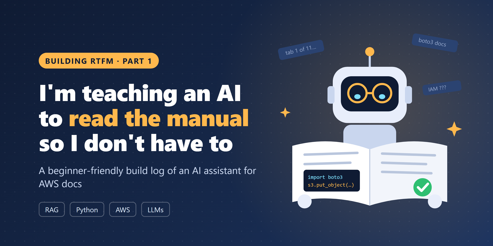
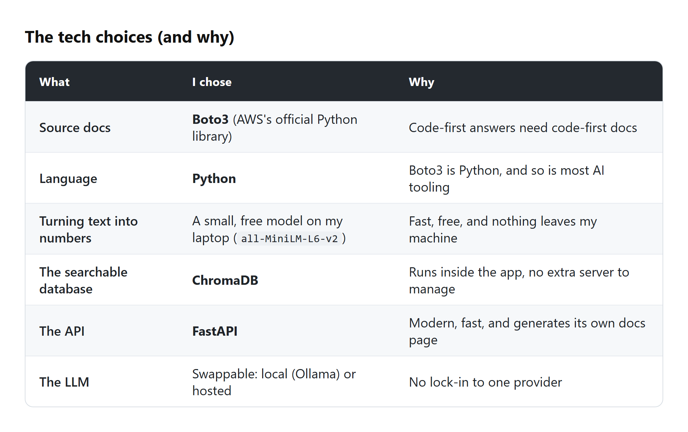

# I'm Teaching an AI to Read the Manual So I Don't Have To



### Part 1 of "Building RTFM": what I'm building, why, and the boring-but-important first step

---

Every developer who has touched AWS knows this feeling.

You want to do something simple. *Upload a file to S3. Encrypted.* Ten minutes later you have eleven browser tabs open, you're reading about something called a "multipart upload," and you've forgotten what you came here for.

The answer was in the documentation all along. It's just that the documentation is roughly the size of a small planet.

So I decided to build something about it. Meet **RTFM Agent**: an AI assistant that reads the AWS documentation *for* you and answers with:

- ✅ working Python code
- ✅ the exact permissions (IAM policy) that code needs
- ✅ links to the pages it got the answer from, so you can check its homework

*(RTFM stands for "Read The F\*\*\*ing Manual." It's what senior engineers have been telling juniors since the dawn of time. Now the AI reads it. Progress.)*

This is a blog series where I build it step by step and explain every decision along the way. No giant code dumps, just the *why*.

---

## "Can't I just ask ChatGPT?"

Fair question! Here's the problem.

A large language model (LLM) is like a very well-read friend who **studied for the exam a while ago**. They remember a lot. But:

1. **Their knowledge has an expiry date.** AWS adds and changes features constantly.
2. **When they don't know, they don't always say so.** They might confidently invent a function name that *sounds* right. This is called **hallucination**, and in code it means "an error at 2 AM."
3. **They can't show their sources.** You just have to trust them.

What I want is a friend who is allowed to **bring the textbook into the exam**.

## Enter RAG: the open-book exam 📖

The technique I'm using is called **RAG: Retrieval-Augmented Generation**. Scary name, simple idea:

> Before the AI answers, we **find the relevant pages** of the documentation and **hand them to the AI** along with the question. The AI then answers *from those pages*.

That's it. Retrieval (find the pages) + Generation (write the answer).

Picture a librarian and a writer working together:

1. 🙋 You ask: *"How do I send a message to an SQS queue?"*
2. 📚 **The librarian** runs to the shelves and comes back with the 5 most relevant pages.
3. ✍️ **The writer** (the LLM) reads only those pages and writes you an answer with code.
4. 🔗 You get the answer *plus* the page references.

Because the writer is working from real pages, it hallucinates far less. And when the docs change, I don't need to retrain anything. I just give the librarian new books.

## The two halves of the project

A RAG system has two phases, and it helped me a lot to see them separately:

**🏭 The offline part (done once, ahead of time): "stocking the library"**

```
AWS docs website → download pages → clean them up → cut into small pieces → convert to numbers → store in a searchable database
```

**⚡ The online part (every time someone asks a question): "answering"**

```
Question → find the most similar pieces → give them to the LLM → answer + code + sources
```

Here's the part nobody warns you about: **the answer can only be as good as the pages the librarian finds**, and the librarian can only find what was stocked properly. Garbage in, confidently-worded garbage out.

So the first half of this series is all about stocking the library *well*. (Spoiler: I got it wrong in some fun and educational ways. That's coming in Parts 3 and 4.)

## The tech choices (and why)



A theme you'll see throughout this series: **start simple, local and free. Upgrade only when you have a measured reason.**

## Step zero: the boring stuff that saves you later 🧹

Before writing a single line of AI code, I set up the project's "plumbing." I know, I know. Nobody gets excited about plumbing. But here's what I did and why each one matters.

### 1. All settings in one place

Every setting (which AI model, how many results to fetch, where to save data) lives in **one configuration file**. Each setting has a type and a sensible default, and any of them can be overridden without touching the code.

**Why?** Imagine changing the AI model and having to hunt through 14 files. Now imagine a typo like `olama` instead of `ollama` crashing the app *halfway through answering someone*. With typed settings, the app refuses to even start with a bad value. Fail early, fail loudly.

Secrets like API keys live in a separate file that **never gets uploaded to GitHub**. (Please, I beg you, never commit your API keys.)

### 2. Logs that machines can read

Instead of printing messages like `"something happened lol"`, every log line is structured data with a timestamp, a severity level and the app name.

**Why?** When this runs in the cloud and something breaks at 3 AM, I want to *search* the logs ("show me every error from production today"), not scroll through them like a medieval scroll.

### 3. An API skeleton with a health check

The app currently does exactly one useful thing: you can ask it "are you alive?" and it says yes. 💓

That sounds silly, but cloud platforms constantly ping your app with this exact question. If it stops answering, they restart it. It's also a clean starting point to add real features to.

I also set it up so heavy things (like loading the AI model) happen **once at startup**, not on every request. Loading a model per question would be like reheating the oven for every single cookie.

### 4. Guard rails

- **Automatic formatting and checks** run before every save to Git, so style debates are settled by a robot.
- A **Docker** setup so the app runs the same on my laptop and in the cloud ("works on my machine" is not a deployment strategy).
- A list of **one-word commands** for common tasks (run, test, format).

None of this is glamorous. All of it means future me spends time on AI problems instead of plumbing problems.

## What's next

With the plumbing in place, it's time to stock the library. In **Part 2**, I build a web crawler that reads hundreds of AWS documentation pages *politely*, without getting my laptop banned. I also share a sneaky trick for keeping code examples intact when converting web pages to text.

See you there! 👋

---

*🧭 Building RTFM, the series:*
1. **I'm Teaching an AI to Read the Manual** ← you are here
2. How to Scrape 2,300 Docs Pages Without Getting Kicked Out
3. Chunky Business: I Was Silently Throwing Away Half My Data
4. Zero Errors, Totally Wrong Data
5. *Coming soon: turning words into numbers (embeddings)*
