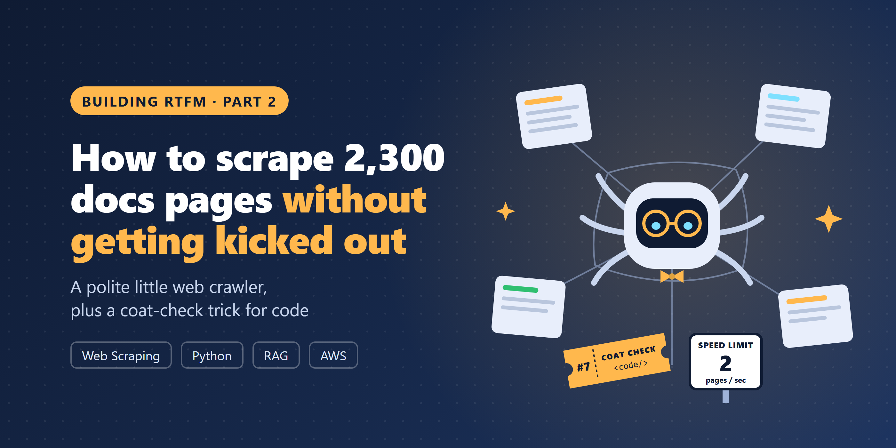

# How to Scrape 2,300 Docs Pages Without Getting Kicked Out

### Part 2 of "Building RTFM": building a polite little web crawler, plus a coat-check trick for code

---

In [Part 1](#), I explained the plan: build an AI assistant that answers AWS questions by first *looking things up* in the official documentation.

Which raises an obvious question: **how does the AI get the documentation in the first place?**

There's no "download all docs" button. There's a website. Thousands of web pages, all linking to each other like a giant spider web. 🕸️

So I built a **crawler**: a small program that visits a page, saves what's on it, finds the links, and visits those too. Today I'll walk through how it works and the decisions behind it.

---

## What a crawler actually does

Imagine you're dropped into a huge library with no catalogue. Your strategy might be:

1. Open a book.
2. Photocopy the useful pages.
3. Write down every other book it mentions on a to-read list.
4. Pick the next book from the list. Repeat.
5. Keep a list of books you've already read, so you don't read the same one forever.

That's a web crawler. Pages are books, links are references, and the "already read" list stops you from going in circles. (Page A links to page B, which links back to page A, which links to page B... you get it.)

I also gave it a **page budget**, a maximum number of pages to visit, because the Boto3 docs cover 400+ AWS services and I'd like to finish before the heat death of the universe.

## Rule #1: Don't be a jerk to the website 🙏

Here's something beginners often don't think about: **every page you download costs the website owner something.** A careless crawler can fire off hundreds of requests a second, which looks a lot like an attack. Best case, you get blocked. Worst case, you actually cause problems for real users.

So my crawler is deliberately polite:

- **🐢 Speed limit:** at most 2 pages per second. That's slow on purpose.
- **🪪 It introduces itself.** Every request says "I'm the RTFM documentation scraper" instead of pretending to be a browser.
- **🚧 It stays in its lane.** It only follows links within the Boto3 docs site, and skips pages with no useful content (search pages, indexes, changelogs, images and stylesheets).
- **🧯 One bad page doesn't stop everything.** If a page fails to load, the crawler notes it and moves on instead of crashing 400 pages into a long run.

At 2 pages per second, the full run took about **20 minutes for 2,300 pages**. A small price for being a good internet citizen.

### 🐛 A bug I found here: reading every page twice

Inside the crawler, two separate steps each needed the page: one extracts the *content*, the other finds the *links*. And each step… downloaded the page itself. So every page was fetched **twice**: double the time, and double the load on AWS's servers.

The fix was to remember the last page downloaded so the second step can reuse it. The detail I like: I remember the **raw page**, not the cleaned-up version. The content step *deletes* the navigation menus (they're noise for the AI), and the navigation menus are exactly where many of the links live. Sharing the cleaned-up copy would have quietly broken link discovery. 🙃

**Lesson:** when two parts of a program share data, check whether either one *changes* it.

## Rule #2: Visit the most useful pages first

With a budget of a few thousand pages, *which* pages you visit matters a lot. My crawler keeps a priority list. It starts from the pages of the **10 most-used AWS services** (S3, EC2, IAM, Lambda, DynamoDB, SQS, SNS, CloudWatch, CloudFormation and RDS) and puts their pages at the front of the queue.

*(Confession: my first version of this priority system was wrong in a way that took me a while to notice, and the story is so good it gets its own post. Stay tuned for Part 4. 😅)*

## Turning a web page into clean text

A web page is mostly *not* content. It's menus, sidebars, footers, "was this page helpful?" buttons and invisible layout scaffolding. If all that goes into the AI's library, the librarian gets confused: every page would "match" a search for "S3," because "S3" is in the sidebar of *every* page.

So for each page, the crawler:

1. Finds the **main content area** and ignores everything around it.
2. Deletes any menus, footers and sidebars still inside it.
3. Converts what's left from HTML into **Markdown**, a simple, readable text format that keeps headings and lists.

## The coat-check trick for code 🧥

Here's my favourite part.

For this project, **code examples are the most valuable content on the page.** The whole point is to answer with working code. But the tool that converts HTML to text has a habit of *mangling* code: squashing indentation, wrapping long lines, adding escape characters. For Python, where indentation *is* the meaning, that's a disaster.

My solution works like a coat check at a fancy party:

1. 🧥 **Before** converting the page, find every code block and take it out.
2. 🎟️ Put a little ticket in its place, a unique label like `CODEBLOCK_7`.
3. 🔄 Convert the rest of the page to text. The ticket is just plain text, so it passes through untouched.
4. 🧥 **After** converting, swap each ticket back for its original, pristine code block.

The converter never touches the code because the code was never there while it worked. The same idea shows up all over programming (it's basically "escaping"), and I love how simple it is.

Bonus: while each code block is checked in, the crawler also guesses its **language** (Python, JSON, shell…) from clues in the page. Later, the AI will know it's looking at Python and not a JSON response.

## Designing for "what if I want more docs later?"

Right now I'm only reading the Boto3 docs. But I'd like to add others later, maybe the AWS CLI or Terraform.

Most of the crawler's job is the same for *any* documentation site: the to-visit list, the "already visited" list, the speed limit, error handling, saving results. Only a few steps are site-specific: *how* to find the main content, *how* to spot code blocks.

So I split it in two:

- A **general crawler blueprint** that handles everything common.
- A **Boto3-specific version** that fills in only the site-specific steps.

Adding a new documentation source later means writing the small site-specific piece, not a whole new crawler. (In software design, this is called the **Template Method pattern**: the parent defines the recipe and the child provides some of the ingredients.)

## Where we are

After this step, I have a crawler that politely visits thousands of docs pages and turns each one into clean, readable text with the code safely intact. 🎉

But I can't hand an AI whole pages. Some of these pages are *enormous*, like a single method with 50 parameters. In **Part 3**, I cut them into bite-sized pieces, and discover that "how big should a piece be?" has a surprisingly precise, *measurable* answer. My first guess was wrong by a lot.

---

*🧭 Building RTFM, the series:*
1. I'm Teaching an AI to Read the Manual
2. **How to Scrape 2,300 Docs Pages Without Getting Kicked Out** ← you are here
3. Chunky Business: I Was Silently Throwing Away Half My Data
4. Zero Errors, Totally Wrong Data
5. *Coming soon: turning words into numbers (embeddings)*
