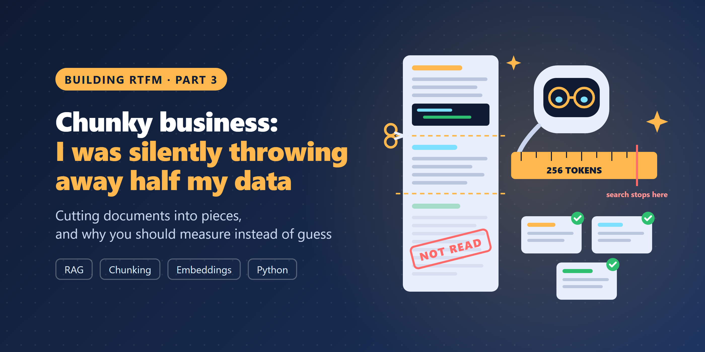
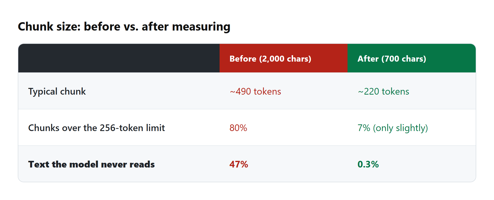

# Chunky Business: I Was Silently Throwing Away Half My Data

### Part 3 of "Building RTFM": cutting documents into pieces, and why you should measure instead of guess

> **📝 Update:** A reader tested the 700-character limit below with the model's own tokenizer and showed it isn't safe for code-heavy text (700 characters came out at 291 tokens). They were right. The chunker now counts tokens directly instead of converting from characters. The full story is in [Part 5](#). Thank you! 🙏

---

Quick recap: in [Part 2](#), I built a crawler that turns AWS documentation pages into clean text.

Now I need to get that text into the AI's "library" so the librarian can find the right bits later. And it turns out you can't just shelve whole pages. You have to **cut them into pieces first**. 🔪

This post covers how I decided where to cut, how big each piece should be, and how a 10-minute measurement showed my first answer was quietly wasting **almost half of everything I'd collected.**

---

## Why cut pages up at all?

Three reasons, from easiest to sneakiest:

**1. Precision.** If you ask "what's the maximum message size for SQS?", you want the *one paragraph* that says so, not a 30-screen page that mentions it somewhere in the middle.

**2. Cost.** Everything we hand the AI costs money and space. Sending 5 small, relevant pieces is much cheaper than sending 5 whole pages.

**3. The sneaky one: the search engine has a reading limit.** We'll come back to this one. It's the plot twist.

These pieces are called **chunks**, and the process is called **chunking**. (Yes, really. The AI world loves a cute name.)

## Cut along the dotted lines ✂️

The lazy way to chunk is to chop every 1,000 characters. Easy, but it slices right through sentences, and worse, *through code examples*. Imagine retrieving a chunk that ends with:

> To create the client, call `boto3.cli`

Useless.

So I cut along the document's **natural structure**, like cutting a pizza along the lines that are already there instead of with a ruler:

1. **First, split at headings.** Each section of a page becomes a candidate chunk. Sections about a topic stay together.
2. **Small sections get merged** with their neighbours, so I don't end up with lonely three-word chunks.
3. **Big sections get split**, but gently. I try the most natural break first and only get more aggressive if I have to:
   - around code blocks (never cut code if avoidable)
   - at sub-headings
   - at paragraph breaks
   - at line breaks
   - at sentence ends
   - and only as a last resort, mid-text 😬
4. Every chunk keeps a note of **which page it came from**, so the final answer can cite its sources.

Each chunk also gets an ID made from its content, so re-running the pipeline produces the *same* IDs. Re-loading data later *updates* existing chunks instead of creating duplicates. (Fancy word for "safe to run twice": **idempotent**.)

## The plot twist: the search engine stops reading 🫣

So how big should a chunk be? My first version used up to **2,000 characters**. It felt reasonable: a few paragraphs, enough context.

To make chunks searchable, each one gets converted into a list of numbers that captures its meaning (more on this in a future post). The small, free model I'm using for that has a **reading limit of 256 "tokens."**

A **token** is roughly a word-piece. "Hello" is one token. Something like `put_bucket_lifecycle_configuration` gets chopped into many.

And here's the catch: **if a chunk is longer than 256 tokens, the model doesn't complain. It just stops reading.** Everything after token 256 is silently ignored. No error, no warning. 🙈

So I stopped guessing and **measured**. I ran the model's own word-splitter over all 2,034 chunks I had at the time:

- AWS docs average about **3.2 characters per token**, because code names and technical terms split into lots of little pieces. (Normal English is closer to 4.)
- My average chunk was around **490 tokens**, nearly *double* the limit.
- **80% of my chunks were over the limit.**
- In total, **47% of all the text I'd carefully collected would never be read.** 💀

Almost half the library was blank pages, and nothing anywhere had told me.

## The fix: do the maths

If the model reads 256 tokens, and dense technical text runs as low as about 2.8 characters per token, then:

> 256 × 2.8 ≈ **700 characters** per chunk

I set the maximum to 700 and stored that number in **one place**, so the cutting step and the quality checks (Part 4) always agree. Then I measured again on real pages:

From half the library missing to basically nothing missing, by changing one number. But I would never have known which number without measuring.

**Lesson:** a limit in the fine print (here, the model's reading limit) can quietly undo everything upstream. Check every limit in your pipeline against your real data.

### Smaller chunks aren't free, though ⚖️

Cutting smaller has a trade-off: a 700-character chunk often loses context. A chunk that says *"Returns a dictionary with the following keys…"* doesn't tell you **which** function returns it. I have a plan for that (adding the page title to each chunk before it's converted into numbers), and it'll come up in the next stage.

## Bonus bugs found along the way 🐛🐛

Shrinking the chunks shook loose two bugs that had been hiding:

**1. Chunks sneaking over the limit.** Each chunk starts with its section heading, but the heading was added *after* checking the size. Long heading + nearly-full chunk = over the limit. I'd seen a 2,034-character chunk when the max was 2,000 and assumed it was a rounding thing. It wasn't. Fix: measure *after* adding the heading.

**2. An infinite loop.** Remember the "split gently, then more aggressively" ladder? Each step is supposed to hand leftovers to a *finer* step. But in one case, a long paragraph sitting right after a code block, the splitter kept handing the same text back to *itself*, forever. Python eventually gave up, the crawler caught the error, and **quietly skipped the whole page.**

With 2,000-character chunks this almost never happened. At 700 characters, long paragraphs are everywhere, so it would have quietly skipped lots of pages. I fixed it, and wrote automated tests that feed exactly those tricky inputs to the chunker. I confirmed the old code fails them and the new code passes, so the bug can't come back unnoticed.

## Where we are

The library now has nicely sized, well-cut pieces that the model can read in full. 🍕

But I'd been feeling pretty confident about this whole data pipeline. No errors, nice numbers, tidy chunks. In **Part 4**, I finally do what I should have done earlier: I look at *what's actually in the library*. And I find out that "no errors" and "correct" are very, very different things.

---

*🧭 Building RTFM, the series:*
1. I'm Teaching an AI to Read the Manual
2. How to Scrape 2,300 Docs Pages Without Getting Kicked Out
3. **Chunky Business: I Was Silently Throwing Away Half My Data** ← you are here
4. Zero Errors, Totally Wrong Data
5. Embeddings and Vector Search, and Why I Stopped Guessing Token Counts
