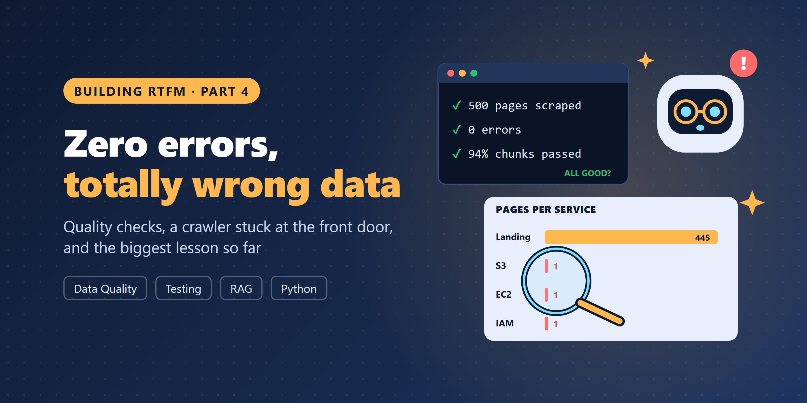
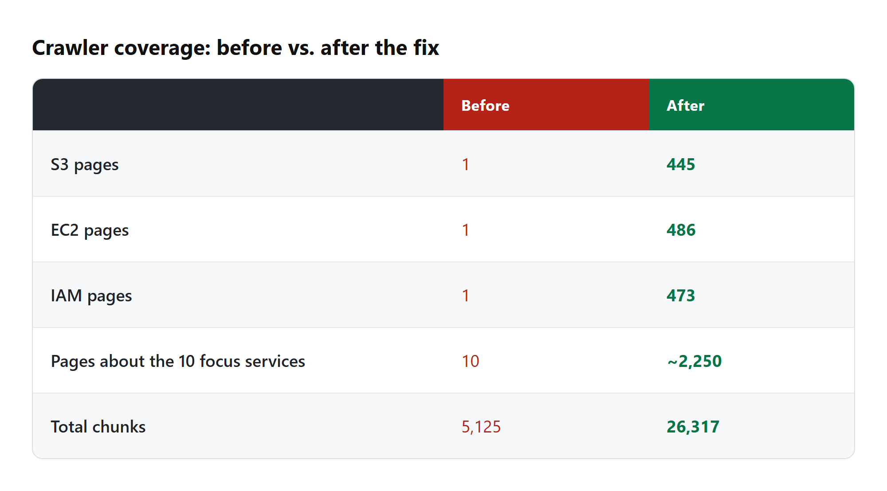

# Zero Errors, Totally Wrong Data

### Part 4 of "Building RTFM": quality checks, a crawler that never went deeper than the front page, and the most important lesson of the project so far

---

So far in this series, I've built a crawler that politely collects AWS documentation ([Part 2](#)) and a chunker that cuts it into pieces my AI can fully read ([Part 3](#)).

Then I ran the whole thing for real. 500 pages. The logs looked *beautiful*:

> ✅ 500 pages scraped
> ✅ 0 errors
> ✅ 94% of chunks passed quality checks

I was ready to celebrate. 🥳

Then I asked one boring question, *"how many pages did I get about S3?"*, and the celebration was cancelled.

---

## First, the quality checks 🔍

Before the twist, here's the quality gate itself, because it's a habit worth stealing.

Before anything goes into the AI's library, every chunk goes through a **validator**, a checklist that flags chunks that are:

- 📏 **too short** (fragments) or **too long** (over the model's reading limit from Part 3)
- 🕳️ **empty**, or just whitespace, or just a heading with nothing under it
- 🏷️ **missing its source**, which would break citations later
- 🧭 **mostly links**, which usually means a leftover navigation menu
- 👯 **duplicates** of a chunk we've already seen

At the end it prints a report: how many chunks passed, what went wrong, and size statistics.

**Why bother?** Every junk chunk in the library is a chunk the librarian might hand to the AI instead of a good one. Checking quality *before* storing is much cheaper than debugging weird answers later.

## Twist #1: the duplicate detector was eating real content 👯

My duplicate check originally compared just **the first 150 characters** of each chunk. If two chunks started the same way, the second one was thrown out. Quick and simple.

When I looked at what it was actually flagging on a sample of 20 pages, it had marked 33 chunks as duplicates. **22 of them weren't duplicates at all.**

Here's why. Every AWS service's docs page has a section about "waiters," and they *all* start with the same sentence:

> *"Waiters are available on a client instance via the get_waiter method…"*

…followed by a **different** list of waiters for each service. S3's section came first, so S3's list was kept. EC2's section started with the same sentence, so it was thrown out as a "duplicate," along with all of EC2's actual content. 😬

Documentation is full of templates, so **shared beginnings are normal**. The fix: only call something a duplicate if the **whole text** matches. Real duplicates still get caught, and different content that happens to start the same way survives.

## Twist #2: the crawler never got past the front door 🚪

Back to my boring question: how many pages did I get about S3?

**One.** The S3 landing page. Same for EC2. Same for IAM. Same for *all 10* of the services I'd specifically told the crawler to focus on.

So what *were* the other 490 pages? I grouped them, and **445 of the 500 pages were landing pages of random AWS services.** Lots of WAF, VPC Lattice and Voice ID. Not a single page for `put_object`, the most common S3 operation there is.

The crawler had read the cover of every book in the library and not one chapter. 📚

### Investigating 🕵️

Two bugs were working together.

**Bug A: "shorter address = more important."** My priority rule said pages with shorter web addresses come first. The idea was "the main page of a service is more important than a sub-page." True in isolation! But there are 400+ AWS services, and each one's main page has a short address. So *every* service's front page outranked *any* actual method page. The crawler dutifully worked through 400+ front pages and ran out of budget.

**Bug B: "only follow the first 100 links."** To keep things tidy, the crawler took at most 100 links from each page. Seems harmless. But when I counted links on the S3 page:

- The page has **693 links**.
- The first ~**520** are the **sidebar**, a menu listing every other AWS service.
- S3's *own* links (the 158 pages about S3's operations) start at around position **523**.

The 100-link cap kept 100 sidebar links and cut off *every single link to S3's own content.* Same for every service, every time. The crawler literally could not see a way deeper.

Neither bug caused an error. Each made total sense alone. Together they made the crawler systematically collect the wrong thing, with a 0% error rate.

### The fixes 🔧

1. **No link cap.** Read every link on the page.
2. **Smarter priorities:** a tier system instead of "shortest address wins."
   - 🥇 the 10 focus services' main pages
   - 🥈 their **operation pages** (the gold: parameters, examples, syntax)
   - 🥉 their lists of paginators and waiters (useful, but repetitive)
   - then tutorials, then everything else
3. **Taking turns.** Within a tier, services take turns: S3, EC2, IAM, Lambda… then S3, EC2, IAM, Lambda again. EC2 alone has over 1,000 sub-pages, and without turn-taking it would eat the whole budget before Lambda got a look in.

I ran it again: **2,300 pages, 20 minutes, 0 errors.** And this time the zero meant something:

### And what about all those duplicates?

The new run flagged **37%** of chunks as duplicates, which sounds alarming. So, lesson learned, I *looked*. They're real: EC2 repeats the same giant list of taggable resource types on **107 different pages**, word for word. Keeping one copy is exactly right. That leaves **16,697 unique chunks**, and they cover the right material this time.

## The lesson I'm taking from all this 🧠

> **"No errors" is not the same as "correct."**

Error messages tell you when the program *couldn't* do what you asked. They will never tell you that you asked for the wrong thing. For that, you have to look at the output and compare it with what you *meant* to get:

- Count things. *(How many pages per service?)*
- Read samples. *(What does a "duplicate" actually look like?)*
- Check the numbers against the goal, not just against "did it crash?"

## Making sure these bugs stay dead: tests 🧪

For every bug in this series, I wrote an **automated test**: a tiny program that checks one specific behaviour and complains loudly if it breaks.

- Does the crawler find links that appear *after* 600 sidebar links?
- Do focus-service pages come before random services?
- Do S3 and EC2 actually take turns?
- Do two chunks with the same opening sentence but different content *both* survive?
- Does each page get downloaded only once?

For each bug, I checked that the test **fails on the old code** and **passes on the new code**. Otherwise the test isn't really protecting anything. The project now has **46 tests** that run in about a second, without needing the internet.

If I break something next month, the tests will tell me before my users do.

## Where we are 🗺️

The library is stocked, with the *right* books this time:

- ✅ 2,300 pages from the 10 most-used AWS services
- ✅ 16,697 unique, well-sized chunks the model can fully read
- ✅ code examples intact, sources attached
- ✅ quality checks and 46 tests guarding it all

Next up is the part that makes it *searchable*: turning every chunk into a list of numbers that captures its meaning, so "how do I upload a file?" can find a chunk about `put_object` even though they share almost no words. That's **embeddings**, and it's where the AI part really begins. 🚀

See you in Part 5!

---

*🧭 Building RTFM, the series:*
1. I'm Teaching an AI to Read the Manual
2. How to Scrape 2,300 Docs Pages Without Getting Kicked Out
3. Chunky Business: I Was Silently Throwing Away Half My Data
4. **Zero Errors, Totally Wrong Data** ← you are here
5. *Coming soon: turning words into numbers (embeddings)*
