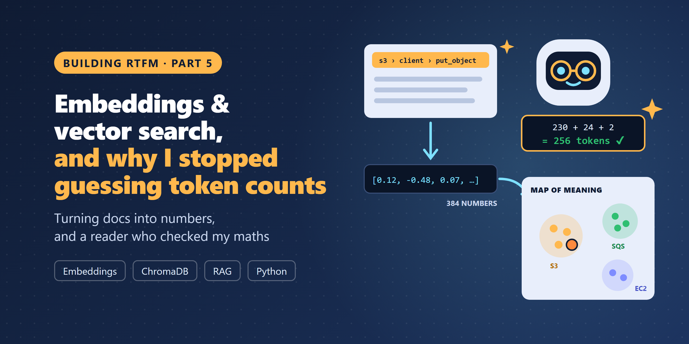

# Embeddings and Vector Search, and Why I Stopped Guessing Token Counts



### Part 5 of "Building RTFM": embeddings, a vector database, 227 chunks that quietly vanished, and a comment that made my chunker better

---

At the end of [Part 4](#), the library was finally stocked with the *right* books: 2,300 pages of AWS docs, cut into about 16,700 clean chunks.

But a library you can't search is just a pile of paper. Today the librarian learns to **find things by meaning**.

This post is also a bit of a confession. A reader left a comment on [Part 3](#) saying my maths was off. I checked. **They were right.** 🙇 More on that below.

---

## Words into numbers 🔢

Here's the problem. A user asks:

> *"How do I send a text message to a phone number?"*

The answer in the AWS docs is a function called `publish`, in a service called SNS. The question and the answer share **almost no words**. A normal keyword search would struggle.

So instead of matching words, we match **meaning**. Every chunk gets turned into a list of numbers, called an **embedding**. Think of it as GPS coordinates on a "map of meaning":

- Chunks about similar things land close together.
- Chunks about unrelated things land far apart.

When a question comes in, it gets turned into coordinates the same way, and the librarian hands back the chunks that are **closest on the map**. 🗺️

I'm using a small, free model called **all-MiniLM-L6-v2**. It turns any text into **384 numbers**, and it runs on my laptop. Nothing gets sent to an outside service, which also matters because this project is going to live near company code one day.

And it works. Here's a real search on the finished index:

> **Q:** *"send a text message to a phone number"*
> 1. `sns > client > publish` ✅
> 2. `sns > client > check_if_phone_number_is_opted_out`
> 3. `sns > topic > publish`

No shared words, right answer first. That's the magic of embeddings. ✨

## Where the numbers live 📦

All those numbers need a home. I'm using **ChromaDB**, a "vector database": a database built for one question, *"which stored items are closest to this one?"*

For every chunk it stores three things:

1. the **numbers** (for searching)
2. the **text** (to hand to the AI later)
3. a **label**: which page it came from, which service, whether it has code (for citations and filtering)

It runs locally too, and I turned off its anonymous usage reporting. My data stays on my machine.

Embedding all 16,697 chunks took about **16 minutes** on my laptop's CPU. It's also **safe to run twice**: chunks already in the database are skipped, so if it crashes halfway through, I just run it again.

## Bug: 227 chunks quietly vanished 👻

Remember from Part 3 that every chunk gets an **ID** made from its content, so that re-loading updates chunks instead of duplicating them?

The ID was made from the page address plus **the first 100 characters** of the chunk.

You might already see where this is going, because it's the same mistake as the duplicate detector in Part 4. AWS docs are full of templates, so **two different chunks on the same page can start with the same 100 characters**. Same page + same beginning = **same ID**.

And when a database sees an ID it already has, it doesn't complain. It just **overwrites** the old one, which is exactly the "safe to run twice" behaviour I wanted. Except now it was overwriting a *different* chunk.

When I counted before loading anything, **227 chunks** shared an ID with another chunk. They would have silently disappeared from the library. No error, of course. 🙃

**Fix:** build the ID from the page address plus the **whole** text. Plus a test that feeds in two chunks with the same opening and checks both survive.

> Second time this series, same lesson: **"the first N characters" is not the same as "the content."**

## Fix: every chunk gets a name tag 🏷️

In Part 3 I mentioned a problem with small chunks: a chunk that says *"Returns a dictionary with the following keys…"* doesn't say **which function** returns it. My plan was to attach each chunk's section heading.

Then I looked at the section headings. Of 16,697 chunks, **16,212 were labelled "Overview."** 😐

Not very helpful.

But the page **address** knows exactly where each chunk comes from:

```
.../reference/services/s3/client/put_object.html
```

So I build a little "breadcrumb" from it and put it at the top of every chunk before it's turned into numbers:

```
s3 > client > put_object

Returns a dictionary with the following keys...
```

Now even a tiny, out-of-context chunk "knows" what it's about, and the search can use that. You can see these name tags in the search results above.

## The comment that made me redo my chunker 💬

This is the comment on Part 3, from a reader who actually tested my numbers (paraphrased):

> *"I ran the model's tokenizer on 700 characters of a boto3 `put_bucket_lifecycle_configuration` call and got 291 tokens, about 2.4 characters per token. And the 256 limit also counts the model's two special tokens. Capping chunks by the tokenizer's own count, title included, is safer than characters."*

Quick recap of what this is about. The model has a **reading limit of 256 tokens** (word-pieces). In Part 3, I converted that to characters: dense text runs at about 2.8 characters per token, so 256 × 2.8 ≈ **700 characters** per chunk.

The reader's point had three parts, and all three held up:

**1. Some text is denser than 2.8.** Code-heavy text can go lower. Their example was 2.4.

**2. The limit isn't really 256.** The model adds two invisible "bookend" tokens to every text, one at the start and one at the end. So only **254** are left for the actual content.

**3. The name tag counts too.** And I'd just added breadcrumbs to the top of every chunk. More tokens, same limit.

So I measured again. This time not just the *average*, but the *worst cases*, across every chunk:


That worst one was a list of EC2 instance type names, nearly every character a separate token. At 700 characters, that chunk came out at **519 tokens**, double the limit.

Overall, after adding the breadcrumbs, **1.6% of chunks were still being cut off**, and about 1% of all the text was never read. Much better than the 47% from Part 3, but not zero. And it's the dense, code-heavy chunks that get cut, which are exactly the ones my users will want.

### The real fix: stop converting, just count 📏

Part 3's mistake wasn't the number 700. It was **converting** at all. "Characters per token" is an average, and averages hide the extremes.

So now the chunker **counts tokens with the model's own tokenizer**, the same one the model uses when it reads. No conversion, no guessing.

The budget is simple maths:

> **256** limit
> − **2** bookend tokens
> − **24** for the longest name tag (23 tokens, plus a blank line)
> = **230 tokens** of content per chunk

Because I'd saved the cleaned pages to disk, I could re-cut everything **without scraping AWS again**. Then I re-embedded the lot:

- ✅ chunks over the limit: **1.6% → 0**
- ✅ text never read: **1% → 0%**
- ✅ fewer, fuller chunks: **16,697 → 14,425**

That last one surprised me at first. But it makes sense: for typical text at 3.7 characters per token, 230 tokens is about **850 characters**, *more* than my old 700. The old rule was too generous for dense chunks and too stingy for normal ones. Counting fixes both.

### A fun gotcha along the way 🐛

One of my old tests checked that a chunk of `"a" * 5000` (five thousand a's) gets split up. In characters, that's huge.

In tokens? **One.** The tokenizer gives up on any "word" longer than 100 characters and turns the whole thing into a single "unknown" token. So the test failed, because the "huge" chunk was actually tiny. I changed it to use realistic text.

(Which also means: if the docs ever contain a giant unbroken string, the model can't read it *at all*. Good to know.)

**Thank you** to that reader. One comment, one test with a real tokenizer, and the pipeline got measurably better. This is the best thing about writing in public. 🙏

## Does the search actually work? 🔍

I tried a handful of questions. Some went really well:

> **Q:** *"block public access to my S3 bucket"*
> → `s3 > client > put_public_access_block` is in the top 3 ✅

And some didn't:

> **Q:** *"turn off a virtual machine"*
> → three CloudFormation pages ❌

The right answer is EC2's `stop_instances`. But AWS calls virtual machines **"instances,"** and my small model doesn't know AWS slang well enough to connect the two.

That made me realise something uncomfortable. I'd been judging my search engine by **trying a few questions and nodding**. Five good-looking results aren't proof of anything. I can't tell if a change makes search better or worse, because I have nothing to measure against.

## Where we are 🗺️

- ✅ 14,425 chunks, each with a name tag, turned into numbers and stored in ChromaDB
- ✅ every chunk fully readable by the model (0% cut off, measured, not estimated)
- ✅ 227 vanishing chunks rescued
- ✅ 80 automated tests

In **Part 6**, I stop nodding at results and build a proper exam for the librarian: 53 questions with known right answers, and a score. It turns out the exam finds problems I never would have spotted by eye, including a whole chunk of EC2 that **was never in the library at all.** 😬

See you there!

---

*🧭 Building RTFM, the series:*
1. I'm Teaching an AI to Read the Manual
2. How to Scrape 2,300 Docs Pages Without Getting Kicked Out
3. Chunky Business: I Was Silently Throwing Away Half My Data
4. Zero Errors, Totally Wrong Data
5. **Embeddings and Vector Search, and Why I Stopped Guessing Token Counts** ← you are here
6. Evaluating Retrieval: My Fancy Hybrid Search Lost to the Simple One
