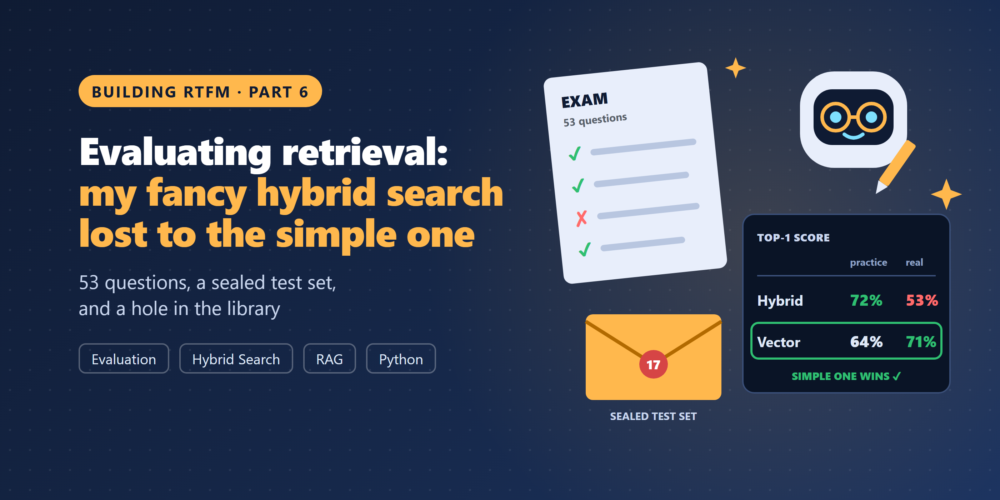

# Evaluating Retrieval: My Fancy Hybrid Search Lost to the Simple One

### Part 6 of "Building RTFM": building an exam for my search engine, the hole it found in my library, and an upgrade that only looked like one

---

At the end of [Part 5](#), my search engine could find SNS `publish` from *"send a text message to a phone number,"* with no shared words. I was impressed.

It also sent *"turn off a virtual machine"* to three CloudFormation pages. Less impressive.

And I realised I'd been judging search quality the way you judge a restaurant from one meal: **try a few things and nod.** That works until you want to change something. Is the new version better? Worse? I had no way to tell.

So this post is about giving my librarian **an exam.** 📝

---

## The exam 📋

I wrote **53 questions**, the kind a real developer would ask:

> *"How do I upload a local file to an S3 bucket?"*
> *"Create a FIFO queue"*
> *"Allow S3 to trigger my Lambda function"*

For each one, I wrote down which docs page(s) actually answer it. For example, the right answer to the FIFO question is `sqs > client > create_queue`.

Then the score is simple. For each question, ask the search engine, and check **where the right page shows up** in the results:

- **Top-1 score** (people call it *Recall@1*): how often is the right page **first**?
- **Top-5 score** (*Recall@5*): how often is it somewhere in the **top 5**? This one matters most, because the AI will be handed the top 5 chunks to write its answer.

(There's a third number in my scripts, called MRR, which rewards "2nd place" more than "5th place." It mostly agrees with the other two, so I'll skip it here.)

Now any change to the search can be **measured** in seconds instead of eyeballed.

### The exam has a sealed envelope ✉️

Here's a trap I wanted to avoid. If I tune the search engine against all 53 questions, I'll end up with a search engine that's good at **my 53 questions**, not at questions in general. It's like a student who memorises last year's paper.

So I split the questions:

- **36 practice questions** (*dev set*): I can look at these as much as I like and tune against them.
- **17 exam questions** (*test set*): sealed. I only open them **once, at the end**, to see if my improvements are real.

Keep that envelope in mind. It's about to matter. 👀

## The first run found a hole in the library 🕳️

I ran the practice questions for the first time and a few scored zero. The search wasn't just ranking the right page low, it **couldn't find it at all.** One of them:

> *"Stop an EC2 instance"* → should find `ec2 > client > stop_instances`

About as basic as EC2 questions get. So I checked the library directly.

**The page wasn't there.** Neither was `run_instances`, probably *the* most famous EC2 operation. Or `terminate_instances`. 😶

Remember Part 4, where I fixed the crawler and proudly reported **486 EC2 pages**? EC2 has **834 operations.** The crawler had been going through them **alphabetically** and ran out of page budget at `describe_vpn_concentrators`. Everything alphabetically after that (`modify_…`, `run_…`, `start_…`, `stop_…`, `terminate_…`) never made it in.

Which means that in Part 5, when *"turn off a virtual machine"* went to CloudFormation, part of the reason was that **the right page didn't exist in the library.** No search engine in the world could have found it.

And here's the bit that stung: Part 4's whole lesson was *"count things and check them against the goal."* I counted. 486 looked like a lot. I just never checked it against **how many there should be.**

**Fix:** raise the budget from 2,300 to **2,800 pages** and re-scrape. EC2 now has **831 of 834** operations, and the library grew to **16,808 chunks**, all still fully readable by the model (the token counting from Part 5 held up).

> **The exam's first job wasn't measuring search quality. It was finding missing data.** A test that finds a bug you weren't looking for has already paid for itself.

(And *"turn off a virtual machine"*? Still misses, even now that `stop_instances` exists. My small model just doesn't know that AWS calls virtual machines "instances." Asking *"Stop an EC2 instance"* finds it fine. That's an honest limitation, and a problem for a later post.)

## Upgrade #1: one chunk per page ✅

The first thing I noticed in the results: a single page often took up **several of the top 5 spots**. Big pages get cut into many chunks, and they all look alike, so they all land near the question on the "map of meaning."

That's a waste. Five chunks from the same page crowd out other pages that might hold the real answer.

The fix is simple: after searching, **keep only the best chunk from each page.**

- Top-5 score on the practice set: **91.7% → 97.2%**
- Top-5 score on all 53: **92.5% → 96.2%**
- None of the scores went down

Easy win. 🎉

## Upgrade #2: hybrid search (looked great 🤩)

Meaning-based search (Part 5) has a known weakness: it can blur **exact words**. If you ask about a "FIFO queue," you really want chunks that literally say "FIFO," not just chunks that *feel* like queues.

The classic fix is **hybrid search**: run two searches and combine them.

1. **Meaning search** (what we already had)
2. **Keyword search**, the old-school kind that counts matching words, and gives extra weight to rare ones. (It's called **BM25**, and it's been around since the '90s.)

To merge the two result lists, there's a neat trick called **Reciprocal Rank Fusion**: a page gets points for being near the top of *either* list, and extra points for being near the top of *both*. It only looks at positions, never scores, so you never have to figure out how a "meaning score" compares to a "keyword score."

On the practice questions, it was a clear upgrade:

- Top-1 score: **64% → 72%** 📈
- *"Upload a local file to an S3 bucket"* went from 5th place to 1st ✅
- *"Set a lifecycle rule so old objects expire automatically"* went from 2nd to 1st ✅

I was ready to make it the default. But first, the sealed envelope.

## Then I opened the envelope 😬

On the 17 sealed questions, hybrid search **dropped from 71% to 53%** for getting the right page first.

The upgrade was only an upgrade on the questions I'd been staring at.

So I looked at the questions where hybrid did worse. They all had the same pattern: the keyword search grabbed a **word** in the question and ran with it, ignoring what the question was actually *asking*:

To be fair, hybrid did win one: *"Create a FIFO queue"* moved from 2nd to 1st, exactly the kind of exact-word question it's meant for. But it lost five.

Keyword search is great at matching words. But developers don't ask questions using the exact words of the API. **Meaning beat keywords on intent.**

So the default is **meaning search + one chunk per page.** Hybrid is still in the code as an option, but it has to earn its place on new questions first.

And if I hadn't sealed that envelope, I'd have shipped a search engine that was **worse**, and been confident it was better. That's the whole reason to do it. 🧠

## Being honest about the result 🙋

A couple of things I want to be upfront about.

**I opened the envelope, so it's not sealed anymore.** I chose the final setup *after* seeing the exam results. That's fine once, but if I keep tweaking and re-checking against the same 17 questions, I'll slowly tune to them too. Next round needs **fresh questions** that I haven't seen results for.

**I wrote both the questions and the search engine.** Without meaning to, I might write questions my own search is good at. Questions from other people would be a much tougher (and fairer) test.

So, an ask: **if you use boto3, what's a question you've actually had to look up?** Leave it in the comments. I'll add the best ones to the next exam, and they'll go straight into the sealed envelope, unseen. 🙏

## Where we are 🗺️

- ✅ an exam: 53 questions, with a sealed test set
- ✅ a library that actually has EC2's most important pages now (831 of 834)
- ✅ the right page in the top 5 for **96%** of questions
- ✅ one honest "no" to a fancier technique, backed by numbers
- ✅ 98 automated tests

The librarian can now reliably find the right pages. Next comes the part this whole project is named for: handing those pages to an AI and getting back **working Python code, the exact IAM permissions it needs, and citations**. Plus an automatic check that the AI isn't inventing permissions that don't exist. (That idea came from another reader comment. You lot are great. 💛)

See you in Part 7!

---

*🧭 Building RTFM, the series:*
1. I'm Teaching an AI to Read the Manual
2. How to Scrape 2,300 Docs Pages Without Getting Kicked Out
3. Chunky Business: I Was Silently Throwing Away Half My Data
4. Zero Errors, Totally Wrong Data
5. Embeddings and Vector Search, and Why I Stopped Guessing Token Counts
6. **Evaluating Retrieval: My Fancy Hybrid Search Lost to the Simple One** ← you are here
7. *Coming soon: generating answers (and catching invented permissions)*
